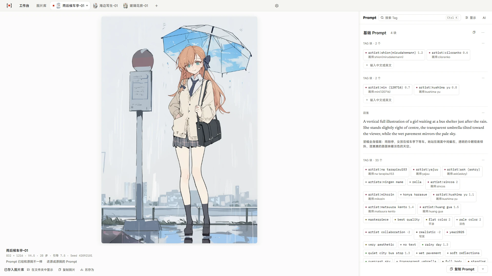
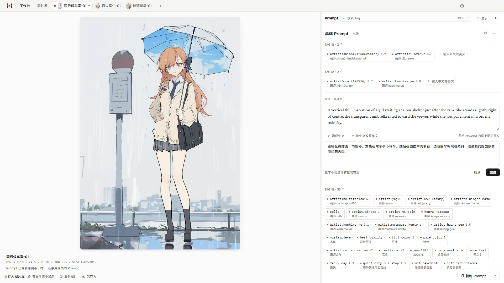
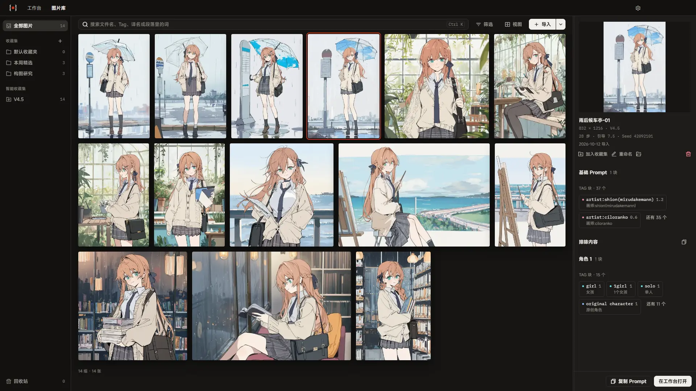
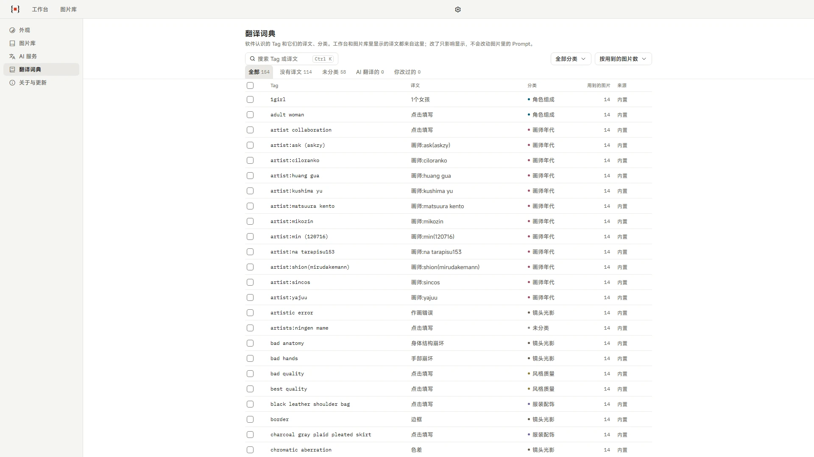

<div align="center">
  

  <h1>NovelAI Prompt Studio</h1>

  <p><strong>让 Prompt 回到创作流程。</strong></p>
  <p>从 NovelAI 图片里找回、整理并再次使用 Prompt 的本地桌面软件。</p>

  <p>
    <a href="https://github.com/LBEILC/NovelAIPromptStudio/releases/latest"><strong>下载最新版</strong></a>
    ·
    <a href="#从一张图片回到完整创作上下文">它能做什么</a>
    ·
    <a href="#快速开始">快速开始</a>
    ·
    <a href="#本地优先不是一句口号">数据与隐私</a>
  </p>
</div>



<p align="center">
  <a href="https://github.com/LBEILC/NovelAIPromptStudio/releases/latest"></a>
  <a href="https://github.com/LBEILC/NovelAIPromptStudio/actions/workflows/release.yml"></a>
  
  <a href="./LICENSE"></a>
</p>

## 从一张图片，回到完整创作上下文

一张生成图不只是最终结果。它还保存着当时使用的基础 Prompt、每个角色的 Prompt、排除内容、模型参数，以及可能内嵌的 Vibe。

NovelAI Prompt Studio 把这些信息从图片里重新带回可读、可编辑的工作区：看清 Prompt 的结构，整理真正属于自己的内容，再把需要的部分准确复制回下一次创作。

| 打开 | 整理 | 复用 |
| --- | --- | --- |
| 从文件、拖放或剪贴板打开图片 | Prompt 按"块"显示：Tag 一块一块，成段的文字单独成段 | 复制全部、当前可见的、选中的，或者只复制某一节 |
| 多张图片保留为独立的标签 | 翻译、分类、搜索、调整权重、拖动换位置 | 原始的顺序、权重、换行和特殊写法原样保留 |
| 识别 NovelAI V4、V4.5 与 V5 | 区分自己写的内容和 NovelAI 自动加的内容 | 存进本地图片库，以后随时找回来 |

> NovelAI Prompt Studio 不生成图片，也不替代 NovelAI。它专注于图片生成之后、下一次创作之前的整理工作。

## 工作台：把 Prompt 看清楚



### Prompt 按"块"组织

NovelAI V5 的 Prompt 常常是 Tag 和成段的自然语言混在一起。工作台把它们分开：一串 Tag 是一个 Tag 块，一段话是一个段落块，各用各的方式显示和编辑。分块只影响显示，复制出去的文字和原来一个字符都不差。分得不对时，可以手动把一块转成另一种，软件会记住。

基础 Prompt、每个角色、各自的排除内容分成不同的节，可以单独收起、单独复制。角色可以添加、改名、移除，最多 22 个。

### 段落：对着中文改英文

点开一个段落，上面是英文、下面是中文，两边都能改。配置了 AI 服务后，可以让它把英文译成中文，或者按你改过的中文重写英文。发给 NovelAI 的始终是上面那一栏英文。

### Tag：输入时有提示

在一个 Tag 块里直接输入，下面会列出候选，输入中文也能找到对应的英文 Tag。候选来自内置的五万多条词典和你自己的翻译词典，不联网。用逗号或换行可以一次加多个。

点一个 Tag 可以改它的文字、译文、分类和权重；拖动可以换位置，可以跨块、跨角色。按住 Ctrl / Cmd 或 Shift 点选，或者从空白处拖出一个框，可以成批复制、移动、翻译或删除。

### 只复制这一次真正需要的内容

"复制 Prompt"复制的是你现在看到的：筛选了就复制筛选出来的，选了几个就复制选中的。旁边的菜单里还有复制全部、只复制某一节、带上 NovelAI 自动加的内容。

译文不会混进复制的内容。排除内容也不会意外进到正向 Prompt 里：两种都选了的时候只复制正向的，并告诉你没有包含几个排除 Tag。

### 把 NovelAI 自动添加的内容与自己的创作区分开

对于可以确认的 NovelAI V4.5 / V5 自动质量词和排除内容预设，工作台会把它们收成一行说明。普通复制不带它们；需要完整复现时，可以选择带上。和官方模板不完全一致的内容，软件不会擅自当成自动内容处理。

### 离线词典优先，AI 是可选的补全助手

软件内置由 [DanbooruSearchOnline（DSO）](https://github.com/SuzumiyaAkizuki/DanbooruSearchOnline) 固定版本转换而来的 52,475 条中文 Tag 译名，并用它的 93 个 Danbooru Tag Group 给常见的外貌、服装、动作、环境、构图和风格 Tag 分类。点"翻译与分类"时，先用你自己改过的结果，再查内置词典和本地规则；内置词典里没有的 Tag 会到 Danbooru 查它属于哪一类（比如是不是画师）；最后还没有译文、而你又配置了 AI 服务的，才交给 AI 补全。

内置词典命中的翻译与分类不需要 AI，也不需要联网。所有结果都记在本机的翻译词典里，可以随时修改，你改过的始终优先。内置数据的版本、生成方式和原始许可证见[第三方数据说明](./third_party/DanbooruSearchOnline/README.md)。

每张打开的图片都有独立的草稿。标签的顺序、当前看的图片和没改完的内容在重启后都会恢复，原图不会被覆盖或改写。

## 图片库：让用过的 Prompt 重新找得到



- 导入 `PNG`、`JPG`、`JPEG`、`WEBP` 或 NovelAI 导出的 `ZIP`，支持多选、拖放和剪贴板。内容相同的图片会自动跳过。
- 图片按原来的比例等高排列，横图竖图放在一起也整齐。
- 选中一张，右边直接显示它的 Prompt，可以当场复制，也可以送到工作台里细看。
- 按文件名、Tag、译名或段落里的词搜索，并结合包含 / 排除 Tag、模型、Vibe 与导入日期筛选。
- Prompt 完全相同、只是 Seed 不同的图片可以合成一摞，也可以按"只有少量 Tag 不同"来合并。
- 用收藏集手动整理，或者把当前的搜索和筛选存成会自动更新的智能收藏集。
- 没有起过名字的图片不显示那一长串文件名。可以给一张或一批图片起名，成批起名会按顺序编号，图片文件本身不改名。
- 支持框选、`Ctrl / Cmd` 加减选择、`Shift` 连选，成批加入收藏集、起名或移入回收站。

删除只是把软件里的那一份移进回收站，可以撤销，也可以随时恢复。永久删除和清空回收站都要确认。

## 翻译词典：把常用的 Tag 一次理顺



设置里的"翻译词典"列出软件认识的所有 Tag 和它们的译文、分类。默认按"用在几张图里"排序，常用的在前面；上面的分页签直接分出还没有译文的、未分类的、AI 翻译的、你改过的。点译文就在格子里改，回车跳到下一行；选中一批可以统一设置分类，或者让 AI 重新翻译。

## 本地优先，不是一句口号

图片、草稿、翻译词典、图片库和设置都保存在这台电脑上。软件不需要账号，也不会上传你的图片。

| 操作 | 对原图的影响 | 会不会联网 |
| --- | --- | --- |
| 打开到工作台 | 只读，不复制、不改写 | 不会 |
| 存入或导入图片库 | 另存一份由软件管理的副本 | 不会 |
| 编辑、筛选或复制 Prompt | 只改本机的草稿 | 不会 |
| 翻译与分类：内置词典里有的 Tag | 不改原图 | 不会 |
| 翻译与分类：内置词典里没有的 Tag | 不改原图 | 把 Tag 的名字发给 Danbooru 查类别；配置了 AI 服务时，还没有译文的再发给你配置的服务 |
| 段落的"译成中文""按中文改写英文" | 不改原图 | 把这一段文字发给你配置的 AI 服务 |
| 检查和下载更新 | — | 访问 GitHub，自动检查可以关掉 |

- 任何情况下都不会发送图片。
- AI 服务的 API Key 用系统自带的加密能力加密后保存在本机，软件不保存明文。
- 从图片库里删除不会动你最初导入的那个文件。
- 另存图片时保留原来的格式和里面的生成信息。
- 图片库的存放位置可以更改；复制并校验完成之前，原来的文件不会被删除。

软件里"设置 → 关于与更新"有同样的说明。

## 支持范围

| 类别 | 当前支持 |
| --- | --- |
| 操作系统 | Windows x64、macOS Apple 芯片、macOS Intel |
| NovelAI Prompt | Diffusion V4、V4.5、V5 |
| 工作台图片 | PNG、JPG / JPEG、WEBP |
| 图片库导入 | PNG、JPG / JPEG、WEBP、NovelAI ZIP |
| 图片里的生成信息 | NovelAI 写在 PNG 里的文本信息，以及可以识别的 Stealth PNG 信息 |
| Vibe | 只读识别，可以导出能恢复的 `.naiv4vibe`；不能在本地编辑或预览效果 |

JPG、WEBP、截图以及被社交平台压缩过的图片仍然可以打开和收藏，但如果里面的生成信息已经丢了，就恢复不出完整的 Prompt。

## 快速开始

1. 前往 [Releases](https://github.com/LBEILC/NovelAIPromptStudio/releases/latest)。
2. 下载适合自己系统的安装包并安装。
3. 启动软件，把一张 NovelAI 生成的图片拖进窗口。
4. 整理、翻译或筛选，然后点 **复制 Prompt**。

| 平台 | 安装包 |
| --- | --- |
| Windows x64 | `NovelAI-Prompt-Studio-Setup-*-x64.exe` |
| macOS Apple 芯片（M 系列） | `NovelAI-Prompt-Studio-*-arm64.dmg` |
| macOS Intel | `NovelAI-Prompt-Studio-*-x64.dmg` |

> [!NOTE]
> 安装包没有做代码签名，Windows 或 macOS 可能会弹出安全提示。请只从本仓库的 Releases 页面下载。

> [!NOTE]
> 从 0.x 升级到 1.0：第一次打开时软件会先自动备份原来的数据库，再升级。图片、收藏集、译文都会保留。

## 常用快捷键

macOS 上 `Ctrl` 对应 `Command`，`Alt` 对应 `Option`。

| 快捷键 | 作用 |
| --- | --- |
| `Ctrl + I` | 打开图片；在图片库里是导入 |
| `Ctrl + V` | 从剪贴板打开或导入图片（在输入框里仍然是普通的粘贴） |
| `Ctrl + K` | 聚焦搜索框 |
| `Ctrl + Tab` / `Ctrl + Shift + Tab` | 下一个 / 上一个标签 |
| `Ctrl + W` | 关闭当前标签 |
| `Alt + 方向键` | 移动当前 Tag |
| 方向键 | 在图片库的图片之间移动 |
| `Enter` / `Space` | 在工作台打开 / 看大图 |
| `Ctrl + A` / `Esc` | 全选图片 / 取消选择、关闭大图 |

完整的列表在软件里的"设置 → 关于与更新"。

## 常见问题

<details>
<summary><strong>会修改我的原图吗？</strong></summary>

不会。工作台只读取原图，改动存在独立的草稿里；图片库保存的是软件自己管理的一份副本。从图片库里删除也不会动你最初导入的那个文件。
</details>

<details>
<summary><strong>必须配置 AI 服务才能用吗？</strong></summary>

不需要。内置词典可以离线翻译和分类它收录的 Tag；AI 只用来补全词典里没有的，以及翻译成段的文字。查看、编辑、筛选、复制 Prompt 和图片库都不依赖 AI。
</details>

<details>
<summary><strong>为什么从剪贴板打开后没有 Prompt？</strong></summary>

软件会优先读取剪贴板里的原始图片数据。但网页上的"复制图片"、截图工具和一部分软件只提供重新编码后的画面，这时图片里的生成信息已经没有了。
</details>

<details>
<summary><strong>数据保存在哪里？</strong></summary>

在系统给每个软件分配的数据目录里：数据库是 `data/studio.sqlite`，图片库的副本和缩略图在 `assets/`。具体位置可以在"设置 → 图片库"里看到，图片的存放位置也可以在那里更改。
</details>

<details>
<summary><strong>这是 NovelAI 官方的软件吗？</strong></summary>

不是。这是面向 NovelAI 工作流的第三方工具，与 NovelAI 或 Anlatan 没有隶属或背书关系。
</details>

## 参与开发

需要 [Node.js 22 或 24](https://nodejs.org/) 及 npm。

```bash
git clone https://github.com/LBEILC/NovelAIPromptStudio.git
cd NovelAIPromptStudio
npm ci
npm run dev
```

```bash
npm run fonts       # 下载并校验界面字体 MiSans（只需一次）
npm test            # 单元测试
npm run typecheck   # 类型检查
npm run build       # 构建前端
npm run verify:app  # 启动真实应用做自动化验收
npm run package     # 生成当前平台的安装包
```

提交改动前，请阅读[项目文档索引](./doc/README.md)与[协作约束](./AGENTS.md)。Windows 和 macOS 是一等支持平台；交互行为由自动化验收在两个平台的 CI 上验证。

维护者发布新版本前请阅读[发版指南](./doc/release-guide.md)。欢迎通过 [Issues](https://github.com/LBEILC/NovelAIPromptStudio/issues) 反馈问题或提出建议。

## 许可证

MiSans VF 不包含在仓库中；开发者运行 `npm run fonts` 从小米官方下载并校验，发布打包必须包含该字体及许可。

当前开发分支及 `v0.9.2` 之后发布的版本采用 [GNU GPLv3](./LICENSE)（`GPL-3.0-only`）。你可以使用、研究、修改和再分发本项目；分发修改版本或安装包时，需要同时按 GPLv3 提供对应源代码并保留许可证声明。

`v0.9.2` 及更早的已发布版本继续适用原 Apache License 2.0。完整的授权边界与历史说明见 [`LICENSES/README.md`](./LICENSES/README.md)。用户导入的图片、Prompt 与其他个人数据不因使用本应用而改用 GPLv3。

内置中文 Tag 数据来自 GPLv3 项目 [DanbooruSearchOnline](https://github.com/SuzumiyaAkizuki/DanbooruSearchOnline)，固定来源、原始数据、许可证与转换说明保存在 [`third_party/DanbooruSearchOnline`](./third_party/DanbooruSearchOnline/README.md)。

---

<div align="center">
  <sub>一张图片，是一次创作留下的完整线索。</sub>
</div>
