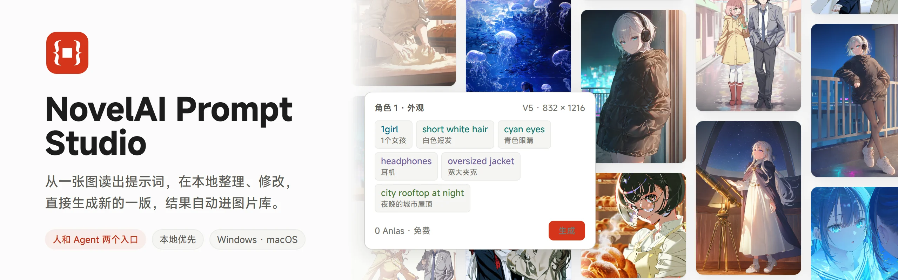
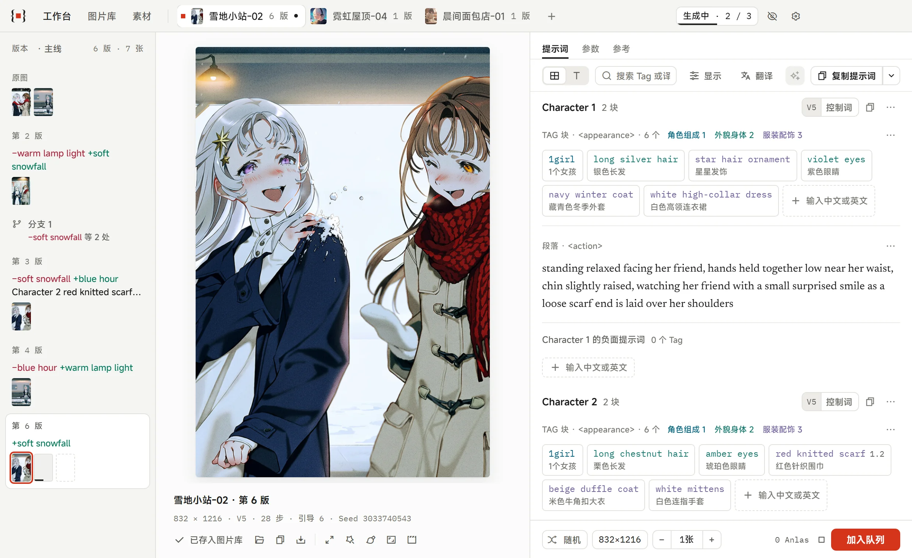
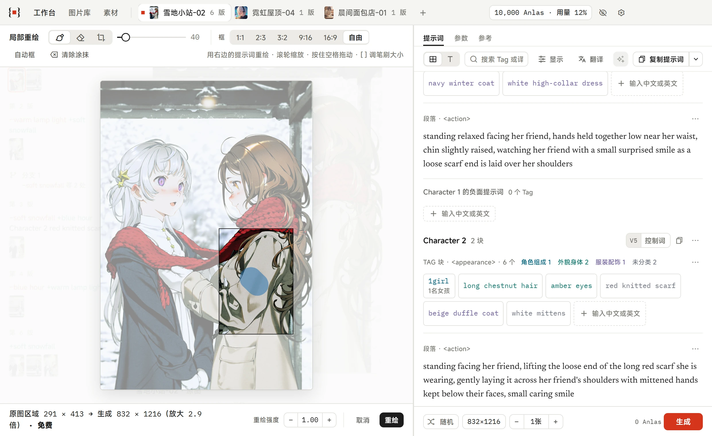

<div align="center">
  <picture>
    <source media="(prefers-color-scheme: dark)" srcset="./doc/screenshots/readme-banner-dark.webp">
    
  </picture>

  <p>
    <a href="https://github.com/LBEILC/NovelAIPromptStudio/releases/latest"><strong>下载最新版</strong></a>
    ·
    <a href="./doc/guide.md">使用指南</a>
    ·
    <a href="#用它做的图">案例图</a>
    ·
    <a href="#数据都在本机">数据与隐私</a>
  </p>

  <a href="https://github.com/LBEILC/NovelAIPromptStudio/releases/latest"></a>
  <a href="https://github.com/LBEILC/NovelAIPromptStudio/actions/workflows/release.yml"></a>
  
  <a href="./LICENSE"></a>
</div>



## 它能做什么

一张 NovelAI 图片里存着当时的提示词、每个角色、负面提示词和全部参数。NovelAI Prompt Studio 把它们读出来，让你在本地看懂、整理、修改，再用你自己的 NovelAI 账号生成新的一版。每一版从哪来、改了什么都自动记下，生成的图自动进图片库。

| 读出 | 整理 | 生成 | 留存 |
| --- | --- | --- | --- |
| 拖进来、粘贴或打开文件，识别 V4、V4.5、V5 | 提示词按块显示，也能像网页一样直接改文字 | 从这张图的参数出发，生成前就知道花多少 | 生成的图自动进图片库，一个作品一组 |
| 分开自己写的和 NovelAI 自动加的 | 五万多条内置中文译文，离线翻译和分类 | 排队、随机池、局部重绘、扩图、导演工具 | 搜索、筛选、收藏集，导出分享原图 |

**人和 Agent 两个入口。** 每项能力都是一条命令：你在界面里用，Claude Code、Codex 这类 Agent 通过命令行工具 `nai-studio` 用同一套。Agent 发起的生成默认要你确认后才发出。

## 用它做的图

下面 24 张都是在软件里用 V5 生成的，角色是原创的。原图在 [`demo/images/showcase`](./demo/images/showcase)，提示词、角色和参数都还在图里：下载一张拖进软件，就能看到它是怎么写的。

**晨间面包店**


**天文台的夜**


**雨季的花伞街**


**夏日水族馆**


**雪地小站**


**霓虹屋顶**


## 改了就生成，每一版都记着


改完提示词点"生成"，新的一版出现在版本栏里，写着相对上一版改了什么。回到旧版本接着改，自动分出新分支。生成中也能接着排队；随机池让每张图各抽一次画师串或动作，一次生成 20 张就是 20 种组合。

## 修图不用离开软件



图片下面一排操作：放大、增强、局部重绘、扩图，还有去背景、上色、换表情这些导演工具。每样都先写好尺寸和价格，结果是新的一版，可以和修之前并排或叠在一起对比。

## 图片库：用过的提示词找得回来


导入图片、ZIP 或整个文件夹，一个作品折叠成一组。按 Tag、译文、模型、日期筛选，选中一张就能复制它的提示词，或者送回工作台接着改。也可以多选导出成 ZIP 分享：导出的是原图，对方拖进来就能看到提示词。

## Agent 帮你做，你来确认


在"设置 → Agent"里安装命令行工具和配套技能，Agent 就能读提示词、改草稿、整理图片库、排队生成。花钱的操作进"待确认"，你点了才发出；永久删除、改设置、读密钥这些它做不了。

```sh
nai-studio workbench.list
nai-studio library.search --json '{"query":"rain","limit":20}'
```

## 快速开始

1. 在 [Releases](https://github.com/LBEILC/NovelAIPromptStudio/releases/latest) 下载安装包，把一张 NovelAI 生成的图拖进窗口。
2. 想在软件里生成：到"设置 → NovelAI 账号"填入持久令牌，也可以用中转站。
3. 想让 Agent 来用：到"设置 → Agent"安装命令行工具，把技能交给你的 Agent。

| 平台 | 安装包 |
| --- | --- |
| Windows x64 | `NovelAI-Prompt-Studio-Setup-*-x64.exe` |
| macOS Apple 芯片（M 系列） | `NovelAI-Prompt-Studio-*-arm64.dmg` |
| macOS Intel | `NovelAI-Prompt-Studio-*-x64.dmg` |

> [!NOTE]
> 安装包没有做代码签名，系统可能会弹出安全提示。请只从本仓库的 Releases 页面下载。
>
> macOS 提示"已损坏，无法打开"时，把应用拖进"应用程序"后，在终端运行一次下面这行再打开：
>
> ```sh
> xattr -dr com.apple.quarantine "/Applications/NovelAI Prompt Studio.app"
> ```

每个功能怎么用、在哪，见[使用指南](./doc/guide.md)；软件里"设置 → 帮助"也能搜索全部功能和快捷键。

## 数据都在本机

- 图片、草稿、版本、图片库、词典和设置都存在这台电脑上，不用注册账号。
- 只有生成和修图时，才用你自己的令牌把提示词和参数发给 NovelAI（或你填的中转站）；修图和图生图会带上要处理的那一张图，别的图不会发出去。
- 令牌、Key 和登录信息用系统的加密能力保存，不进备份和诊断；Agent 和命令行读不到。
- 原图不会被改写；删除只是移进回收站，可以恢复。

每项操作会不会联网、动不动原图，见指南里的[数据与隐私](./doc/guide.md#数据与隐私)。

## 常见问题

<details>
<summary><strong>生成要花钱吗？</strong></summary>

和在 NovelAI 网页上一样，按 NovelAI 的规则扣你账号里的 Anlas 或 V5 免费用量，软件本身不收费。生成前一直显示这次要花多少，超出免费范围时说明原因，可以一键改回免费的尺寸。
</details>

<details>
<summary><strong>这样用符合 NovelAI 的条款吗？</strong></summary>

NovelAI 的公开接口文档写明第三方工具可以向用户索取持久令牌；但生成接口要求请求由人的操作发起，服务条款也限制自动化。所以软件默认一张一张地发，无人值守的连续生成默认关闭，Agent 的生成默认要你确认。这是非官方工具，**是否符合条款由你自己判断并承担**。
</details>

<details>
<summary><strong>这是 NovelAI 官方的软件吗？</strong></summary>

不是。这是面向 NovelAI 工作流的第三方工具，与 NovelAI 或 Anlatan 没有隶属或背书关系。
</details>

更多问题见[使用指南](./doc/guide.md#常见问题)。

## 现在的状态

1.9 是稳定版，功能已经齐了，之后以修问题为主。遇到问题或者想要什么功能，欢迎在 [Issues](https://github.com/LBEILC/NovelAIPromptStudio/issues) 里说。

## 参与开发

需要 [Node.js 22 或 24](https://nodejs.org/) 及 npm。

```bash
git clone https://github.com/LBEILC/NovelAIPromptStudio.git
cd NovelAIPromptStudio
npm ci
npm run fonts   # 下载并校验界面字体 MiSans（只需一次）
npm run dev
```

`npm test`、`npm run typecheck`、`npm run build`、`npm run verify:app`（启动真实应用做自动化验收）、`npm run package`。提交改动前请阅读[项目文档索引](./doc/README.md)与[协作约束](./AGENTS.md)；维护者发版前请阅读[发版指南](./doc/release-guide.md)。

## 许可证

`v0.9.2` 之后的版本采用 [GNU GPLv3](./LICENSE)（`GPL-3.0-only`），`v0.9.2` 及更早的版本继续适用 Apache License 2.0，详见 [`LICENSES/README.md`](./LICENSES/README.md)。用户导入的图片、提示词与其他个人数据不因使用本应用而改用 GPLv3。

内置中文 Tag 数据来自 GPLv3 项目 [DanbooruSearchOnline](https://github.com/SuzumiyaAkizuki/DanbooruSearchOnline)，见 [`third_party/DanbooruSearchOnline`](./third_party/DanbooruSearchOnline/README.md)。MiSans VF 不包含在仓库中，`npm run fonts` 从小米官方下载并校验，发布包含该字体及许可。

---

<div align="center">
  <sub>一张图片，是一次创作留下的完整线索。</sub>
</div>
