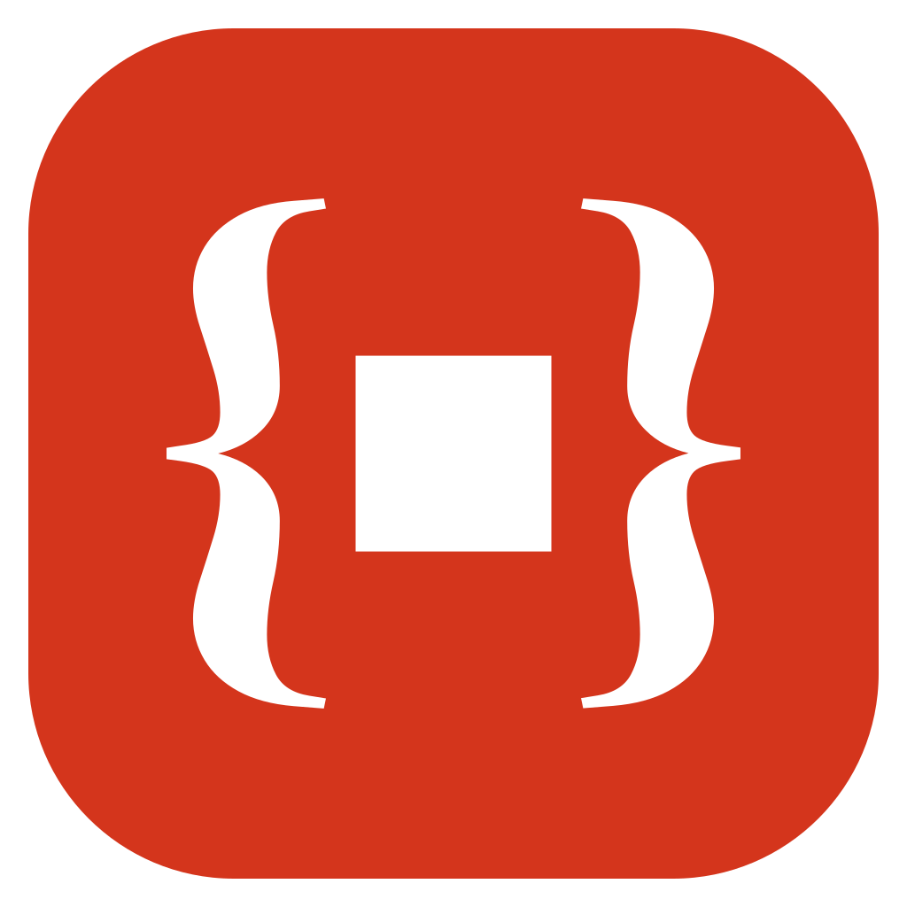
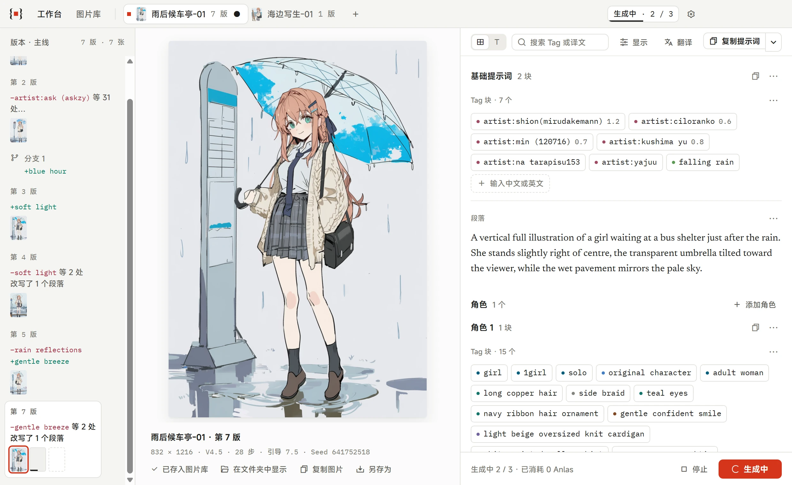
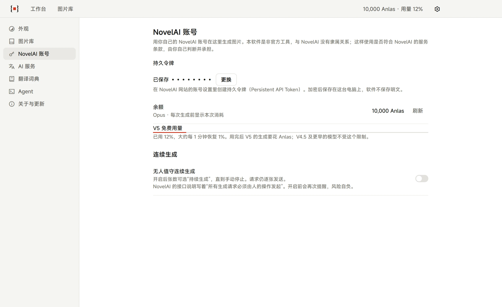
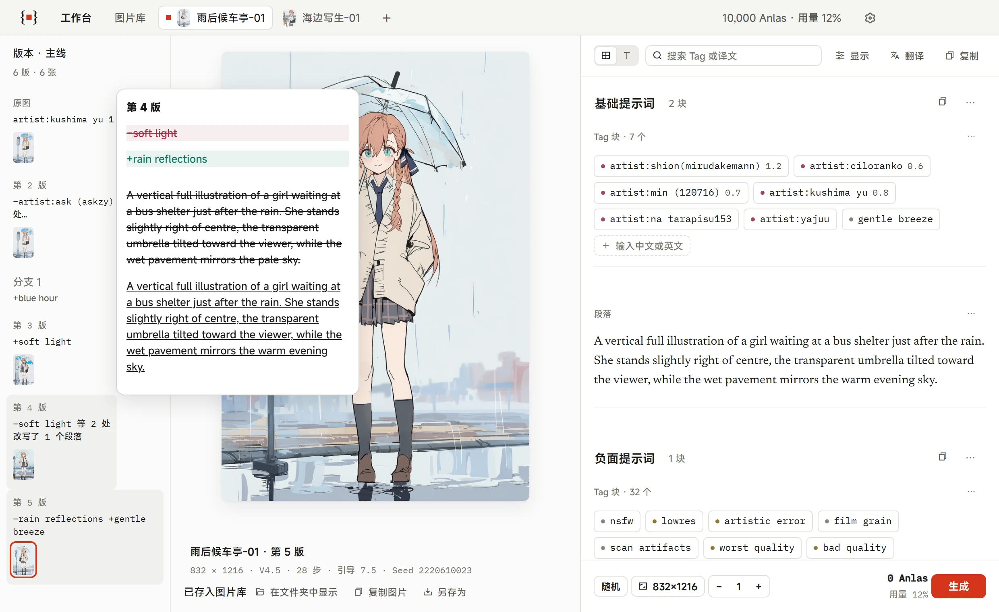
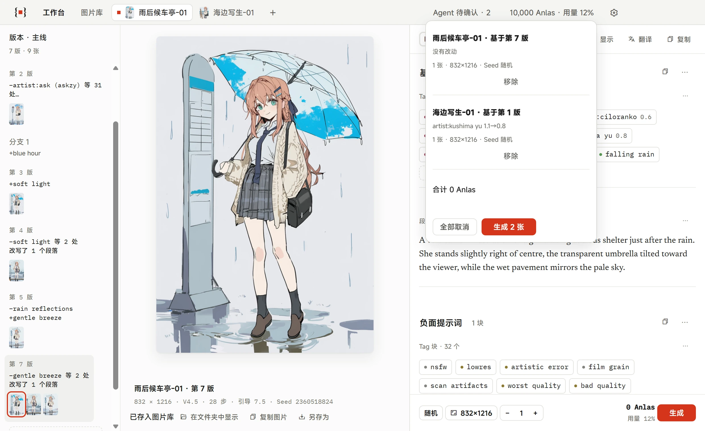
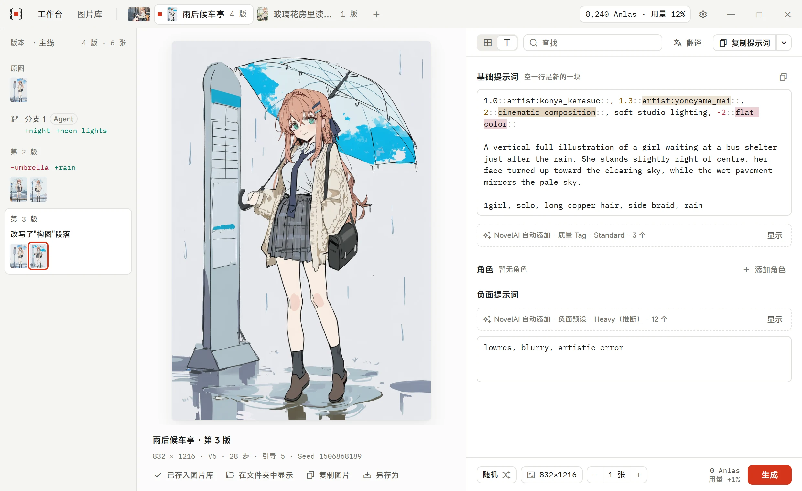
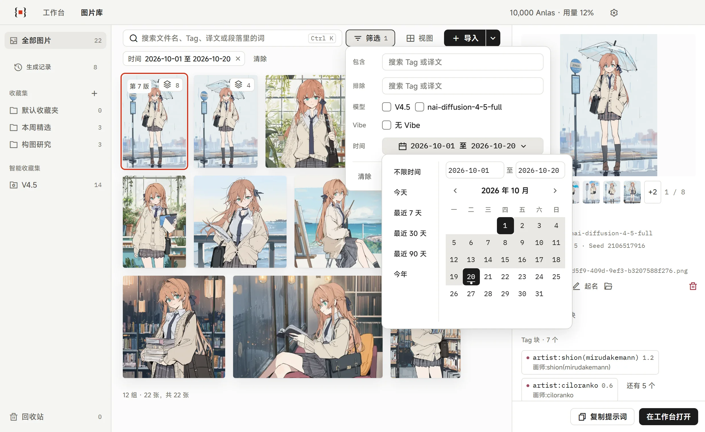
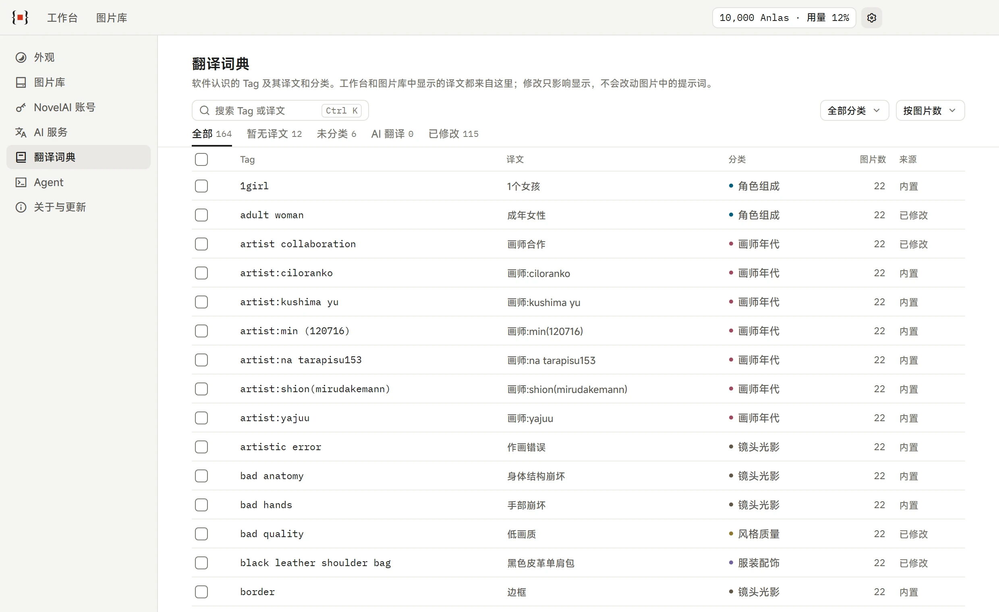

<div align="center">
  

  <h1>NovelAI Prompt Studio</h1>

  <p><strong>本地的 NovelAI 创作工作台，人和 Agent 两个入口。</strong></p>
  <p>从一张图读出提示词，在本地整理、修改，直接生成新的一版，结果自动进图片库。</p>

  <p>
    <a href="https://github.com/LBEILC/NovelAIPromptStudio/releases/latest"><strong>下载最新版</strong></a>
    ·
    <a href="#一个完整的创作循环">它能做什么</a>
    ·
    <a href="#快速开始">快速开始</a>
    ·
    <a href="#数据都在本机">数据与隐私</a>
  </p>
</div>

<!-- 发版前换成软件截图 -->


<p align="center">
  <a href="https://github.com/LBEILC/NovelAIPromptStudio/releases/latest"></a>
  <a href="https://github.com/LBEILC/NovelAIPromptStudio/actions/workflows/release.yml"></a>
  
  <a href="./LICENSE"></a>
</p>

## 一个完整的创作循环

一张 NovelAI 图片里存着当时的基础提示词、每个角色的提示词、负面提示词、全部生成参数，有时还有 Vibe。NovelAI Prompt Studio 把它们读出来，让你在本地看懂、整理、修改，然后用你自己的 NovelAI 账号直接生成新的一版。每一版是从哪张图、哪一版、改了什么得来的，软件都自动记下；生成的图自动进图片库，以后找出来接着用。

以前要"复制出去、到 NovelAI 网页生成、再把图拖回来"，现在这一步接上了。

| 读出 | 整理 | 生成 | 留存 |
| --- | --- | --- | --- |
| 从文件、拖放或剪贴板打开图片，每张一个标签页 | 提示词按"块"显示，也可以像 NovelAI 网页一样直接改文字 | 从这张图的参数出发，只改你改动的部分 | 生成的图自动存进图片库 |
| 识别 NovelAI V4、V4.5 与 V5 | 翻译、分类、调权重、拖动换位置 | 生成前一直显示这次要花多少 | 搜索、筛选、收藏集，详情栏直接复制提示词 |
| 区分自己写的内容和 NovelAI 自动加的内容 | 复制时原样保留顺序、权重和写法 | 版本和分支自动记录 | 一个作品折叠成一组 |

**人和 Agent 两个入口。** 软件的每项能力都是一条命令。你在界面里用；Claude Code、Codex 这类能运行命令的 Agent 通过命令行工具 `nai-studio` 用同一套能力：读提示词、改草稿、整理图片库、排队生成。Agent 发起的生成默认要你确认后才发出。

## 生成与版本

改完提示词，点"生成"就在软件里出图。

### 用你自己的 NovelAI 账号

在"设置 → NovelAI 账号"里填入持久令牌（在 NovelAI 网站的账号设置里创建）。令牌用系统自带的加密能力加密后保存在本机，软件不保存明文。配置好以后，标题栏一直显示 Anlas 余额和 V5 免费用量。

不填也能用软件的其他功能，只是没有生成和版本栏。

<!-- 发版前换成软件截图 -->


### 永远从一张图出发

生成以当前这一版的参数为起点，只改你改动的部分：提示词、角色、负面提示词、Seed、张数和尺寸（竖图、横图、方图，或者自定义）。图里其余的参数原样带上。不做从零开始的参数表单。

### 生成前就知道要花多少

"生成"左边一直显示这次要花多少：免费时是"0 Anlas · 用量 +N%"，收费时是要花的 Anlas 和当前余额。不在免费范围时，会说明原因和要花多少，并且可以一键改回免费的尺寸。花钱只提醒，余额不够时才不能生成。

### 请求一张接一张

全软件同一时间只有一个生成请求，一张发完再发下一张。生成好的图一张张出现在版本栏里；可以随时停止，当前这张完成后就停下，没发出的不再发。生成失败时会停下，说明原因和有没有花 Anlas，可以只重试失败的那一张。

张数不设上限，反正都是一张一张地发。无人值守的连续生成（"持续生成，直到停止"）默认关闭，要在"设置 → NovelAI 账号"里手动打开，打开前会引用 NovelAI 条款的原文提醒一次。

### 版本和分支自动记录

<!-- 发版前换成软件截图 -->


- 一个标签页是一个**作品**：一张原图，加上从它改出来的各个版本。每一版下面是它生成的若干张图。
- 提示词和参数都没改（只换了 Seed、张数）就生成，图加进当前这一版；改了再生成，出新的一版。
- 回到旧版本接着改，自动分出新分支，不需要手动创建。从原图一路下来的叫"主线"，之后按先后叫"分支 1""分支 2"……可以改名。
- 版本栏只显示你正在走的这条线，别的分支在分叉处收成一行。每一版写着相对上一版改了什么（Tag 的增减和权重、段落、尺寸），停一下就弹出完整对比。
- 改得够多、觉得已经是另一幅作品了，就从一张图"作为新作品打开"，另起一个标签页，新旧两边可以互相跳。

### 生成的图自动进图片库

不用手动保存，生成好的图不会丢。一个作品在图片库里折叠成一组，侧栏的"生成记录"按时间列出软件生成的全部图片。

## Agent 与命令行

<!-- 发版前换成软件截图 -->


软件提供命令行工具 `nai-studio` 和一份配套的 Agent 技能。Claude Code、Codex 这类能运行命令的 Agent 用上它们，就能帮你整理提示词、批量处理图片库、排队生成，用的是和界面同一套能力。

- **安装**：在"设置 → Agent"里安装命令行工具，再把 Agent 技能放进你的 Agent 的技能目录（可以打开技能所在的文件夹，或者直接复制内容）。
- **只在这台电脑上**：`nai-studio` 连到正在运行的软件上执行命令，不直接读写数据库，也不开网络端口。软件没开时会先把它打开。输出一律是 JSON。
- **能做什么**：读提示词和参数、工作台、图片库和翻译词典；改工作台的草稿（块、Tag、权重、段落、角色、尺寸）；导入图片、存入图片库、起名、整理收藏集、修改翻译词典；排队生成。
- **不能做什么**：永久删除、清空回收站、改设置、读取或修改任何密钥、确认或放弃待确认的生成。这些限制写在软件的命令层里，不靠界面拦。
- **改了看得见、撤得回**：Agent 改了当前标签页，提示词原地更新，通知"Agent 修改了提示词"，带"撤销"。你正在输入的那一块不会被冲掉。

### Agent 的生成默认等你确认

- Agent 只能排队。标题栏出现"Agent 待确认 · N"，点开能看到每一项：哪张图、基于第几版、改了什么、几张、尺寸、Seed。可以移除其中一项，然后"全部取消"或者"生成"。没确认的不发出，也不花钱。
- 确认后照样一张接一张地发。Agent 的生成另起一版，不换你正在看的图、正在改的提示词；它生成的版本一直带着"Agent"标记。
- "直接生成"（不用确认）要在"设置 → Agent"里手动打开，打开时会提醒风险。每日花费上限默认关闭，打开后可以设每天最多花多少 Anlas，到了就暂停 Agent 的生成。

```sh
nai-studio app.status
nai-studio workbench.list
nai-studio library.search --json '{"query":"rain","limit":20}'
```

`nai-studio help` 列出当前版本支持的全部命令；用法和边界见 [Agent 技能](./agent/SKILL.md)。

## 工作台：把提示词看清楚

### 提示词按"块"组织

NovelAI V5 的提示词常常是 Tag 和成段的自然语言混在一起。工作台把它们分开：一串 Tag 是一个 Tag 块，一段话是一个段落，各用各的方式显示和编辑。分块只影响显示，复制出去的文字和原来一个字符都不差。分得不对时，可以手动把一块转成另一种，软件会记住。

基础提示词、每个角色、负面提示词各是一节，可以单独复制。角色可以添加、改名、删除，每个角色有自己的负面提示词。

### 文本方式：像 NovelAI 网页一样直接改

<!-- 发版前换成软件截图 -->


不习惯按块、按 Tag 改的，可以切到文本方式，直接改整段文字。写法和 NovelAI 网页一样：逗号分开，`1.2::rain::` 是权重，`{ }` `[ ]` 加强减弱。

- 输入时有补全，中文也能找到英文 Tag；指针停在一个 Tag 上可以看译文。
- 括号没配对、`::` 不成对时，那一处画上波浪线，下面写明是第几行出的问题。
- 按每个字实际的权重铺底色：加强、减弱和负数各一种颜色，越强颜色越深。
- `Ctrl + E` 在按块和按文本之间切换，软件记住你选的方式。切回按块时重新分块，译文和分类都保留。

### 段落：对着中文改英文

点开一个段落，上面是英文、下面是中文，两边都能改。配置了 AI 服务后，可以"翻译成中文"，或者"根据中文改写英文"。发给 NovelAI 的始终是上面那一栏英文。

### Tag：输入时有提示

在一个 Tag 块里直接输入，下面会列出候选，输入中文也能找到对应的英文 Tag。候选来自内置的五万多条词典和你自己的翻译词典，不联网。用逗号或换行可以一次加多个。

点一个 Tag 可以改它的文字、译文、分类和权重；拖动可以换位置，可以跨块、跨角色。按住 Ctrl / Cmd 或 Shift 点选，或者从空白处拖出一个框，可以成批复制、移动、翻译或删除。

### 只复制这一次真正需要的内容

"复制提示词"复制的是你现在看到的：筛选了就复制筛选出来的，选了几个就复制选中的。旁边的菜单里还有复制全部提示词、复制负面提示词、只复制基础提示词、带上 NovelAI 自动添加的内容。

译文不会混进复制的内容。只选了负面就复制负面；正面和负面都选了时只复制正面的，并告诉你没有包含几个负面 Tag，免得把负面粘进正面。

### 把 NovelAI 自动添加的内容与自己的创作区分开

对于可以确认的 NovelAI V4.5 / V5 质量 Tag 和负面预设，工作台会把它们收成一行说明。普通复制不带它们；需要完整复现时，可以选择带上。和官方模板不完全一致的内容，软件不会擅自当成自动添加的内容处理。

### 内置词典优先，AI 是可选的补全助手

软件内置由 [DanbooruSearchOnline（DSO）](https://github.com/SuzumiyaAkizuki/DanbooruSearchOnline) 固定版本转换而来的 52,475 条中文 Tag 译文，并用它的 93 个 Danbooru Tag Group 给常见的外貌、服装、动作、环境、构图和风格 Tag 分类。点"翻译"时，先用你自己改过的结果，再查内置词典和本地规则；内置词典里没有的 Tag 会到 Danbooru 查它属于哪一类（比如是不是画师）；最后还没有译文、而你又配置了 AI 服务的，才交给 AI 补全。

内置词典命中的翻译与分类不需要 AI，也不需要联网。所有结果都记在本机的翻译词典里，可以随时修改，你改过的始终优先。内置数据的版本、生成方式和原始许可证见[第三方数据说明](./third_party/DanbooruSearchOnline/README.md)。

每个标签页都有独立的草稿。标签页的顺序、当前看的图片和没改完的内容在重启后都会恢复，原图不会被覆盖或改写。

## 图片库：让用过的提示词重新找得到

<!-- 发版前换成软件截图 -->


- 导入 `PNG`、`JPG`、`JPEG`、`WEBP` 或 NovelAI 导出的 `ZIP`，支持多选、拖放和剪贴板。内容相同的图片会自动跳过。
- 图片按原来的比例等高排列，横图竖图放在一起也整齐。
- 选中一张，右边直接显示它的提示词，可以当场复制，也可以送到工作台里接着改。
- **一组**：一个作品（原图和从它生成的各版）是一组；另外可以把提示词完全相同、基础相同或者相似的图合成一组。一组有封面，可以逐张翻看、换封面。
- 按文件名、Tag、译文或段落里的词搜索，并结合包含 / 排除 Tag、模型、Vibe 与导入时间筛选。导入时间用**日期范围**选：今天、最近 7 天、最近 30 天……，或者在月历上点开始和结束，有图片的日子带一个小点。
- 用收藏集手动整理；或者把当前的筛选存成**智能收藏集**，之后随时编辑规则，图片实时跟着变。
- 侧栏的**生成记录**列出软件生成的全部图片，最新的在前，每张写着是第几版、是不是 Agent 生成的。
- 没有起过名字的图片不显示那一长串文件名。可以给一张或一批图片起名，成批起名会按顺序编号，图片文件本身不改名。
- 支持框选、`Ctrl / Cmd` 加减选择、`Shift` 连选，成批加入收藏集、起名或移入回收站。

删除只是把软件里的那一份移进回收站，可以撤销，也可以随时恢复。永久删除和清空回收站都要确认。

## 翻译词典：把常用的 Tag 一次理顺

<!-- 发版前换成软件截图 -->


设置里的"翻译词典"列出软件认识的所有 Tag 和它们的译文、分类。默认按"用在几张图里"排序，常用的在前面；上面的分页签直接分出暂无译文的、未分类的、AI 翻译的、你改过的。点译文就在格子里改，回车跳到下一行；选中一批可以统一设置分类，或者让 AI 重新翻译。

## 数据都在本机

图片、草稿、版本记录、翻译词典、图片库和设置都保存在这台电脑上。软件本身不需要注册账号，也不会上传你的图片；只有生成时才用你自己的 NovelAI 账号。

| 操作 | 对原图的影响 | 会不会联网 |
| --- | --- | --- |
| 打开到工作台 | 只读，不复制、不改写 | 不会 |
| 存入或导入图片库 | 另存一份由软件管理的副本 | 不会 |
| 编辑、筛选或复制提示词 | 只改本机的草稿 | 不会 |
| 生成图片 | 不改原图，生成的图存进图片库 | 用你的持久令牌把提示词和参数发给 NovelAI；带 Vibe 的图会带上图里的 Vibe 编码 |
| 查询余额 | — | 打开软件、每次生成结束和点"刷新"时，向 NovelAI 查询 Anlas 余额和用量 |
| Agent 通过命令行操作 | 和你在界面里操作一样 | 不会：命令行工具只在这台电脑上和软件通信，不开网络端口 |
| 翻译与分类：内置词典里有的 Tag | 不改原图 | 不会 |
| 翻译与分类：内置词典里没有的 Tag | 不改原图 | 把 Tag 的名字发给 Danbooru 查类别；配置了 AI 服务时，还没有译文的再发给你配置的服务 |
| 段落的"翻译成中文""根据中文改写英文" | 不改原图 | 把这一段文字发给你配置的 AI 服务 |
| 读取模型列表、测试连接 | — | 只和你配置的 AI 服务通信，不带你的提示词 |
| 检查和下载更新 | — | 访问 GitHub，自动检查可以关掉 |
| 报告问题、提出建议 | — | 在浏览器里打开 GitHub，不自动附带任何数据 |

- 任何情况下都不会发送图片。
- NovelAI 的持久令牌和 AI 服务的 API Key 都用系统自带的加密能力加密后保存在本机，软件不保存明文；诊断信息和报告问题都不会带上它们。
- 从图片库里删除不会动你最初导入的那个文件。
- 另存图片时保留原来的格式和里面的生成信息。
- 图片库的存放位置可以更改；新位置的文件复制完成并确认无误之前，原来的文件不会被删除。

软件里"设置 → 关于与更新"有同样的说明。

## 支持范围

| 类别 | 当前支持 |
| --- | --- |
| 操作系统 | Windows x64、macOS Apple 芯片、macOS Intel |
| NovelAI 提示词 | Diffusion V4、V4.5、V5 |
| 在软件里生成 | 从一张图出发，用这张图的模型生成；能生成哪些模型以软件里的为准 |
| 工作台图片 | PNG、JPG / JPEG、WEBP |
| 图片库导入 | PNG、JPG / JPEG、WEBP、NovelAI ZIP |
| 图片里的生成信息 | NovelAI 写在 PNG 里的文本信息，以及可以识别的 Stealth PNG 信息 |
| Vibe | 识别图里的 Vibe，可以导出能恢复的 `.naiv4vibe`；生成时原样带上，暂时不能调整 |

JPG、WEBP、截图以及被社交平台压缩过的图片仍然可以打开和收藏，但如果里面的生成信息已经丢了，就恢复不出完整的提示词。

## 快速开始

1. 前往 [Releases](https://github.com/LBEILC/NovelAIPromptStudio/releases/latest)。
2. 下载适合自己系统的安装包并安装。
3. 启动软件，把一张 NovelAI 生成的图片拖进窗口。
4. 整理、翻译或筛选，然后点 **复制提示词**。
5. 想在软件里生成：到"设置 → NovelAI 账号"填入持久令牌，改完提示词点 **生成**。
6. 想让 Agent 来用：到"设置 → Agent"安装命令行工具，把 Agent 技能交给你的 Agent。

| 平台 | 安装包 |
| --- | --- |
| Windows x64 | `NovelAI-Prompt-Studio-Setup-*-x64.exe` |
| macOS Apple 芯片（M 系列） | `NovelAI-Prompt-Studio-*-arm64.dmg` |
| macOS Intel | `NovelAI-Prompt-Studio-*-x64.dmg` |

> [!NOTE]
> 安装包没有做代码签名，Windows 或 macOS 可能会弹出安全提示。请只从本仓库的 Releases 页面下载。

> [!NOTE]
> 升级到 1.2：第一次打开时，软件会先备份数据库，再清理 1.0 之前留下、早已不用的旧数据表。图片、收藏集、译文都会保留。

## 常用快捷键

macOS 上 `Ctrl` 对应 `Command`，`Alt` 对应 `Option`。在输入框里，`Ctrl + V` 仍然是普通的粘贴。

**通用**

| 快捷键 | 作用 |
| --- | --- |
| `Ctrl + I` | 打开图片；在图片库里是导入 |
| `Ctrl + V` | 从剪贴板打开或导入图片 |
| `Ctrl + K` | 聚焦搜索框 |
| `Ctrl + Tab` / `Ctrl + Shift + Tab` | 下一个 / 上一个标签页 |
| `Ctrl + W` | 关闭当前标签页 |

**工作台**

| 快捷键 | 作用 |
| --- | --- |
| `Ctrl + E` | 切换按块 / 按文本编辑 |
| `Alt + 方向键` | 移动当前 Tag 或块 |
| `←` / `→` | 在这一版的图之间切换 |
| `Esc` | 取消选择 |

**图片库**

| 快捷键 | 作用 |
| --- | --- |
| 方向键 | 在图片之间移动 |
| `Enter` / `Space` | 在工作台打开 / 看大图 |
| `←` `→` / `↑` `↓` | 大图里换一张 / 换一组 |
| `Ctrl + A` | 全选图片 |
| `Esc` | 取消选择；关闭大图 |

完整的列表在软件里的"设置 → 关于与更新"。

## 常见问题

<details>
<summary><strong>会修改我的原图吗？</strong></summary>

不会。工作台只读取原图，改动存在独立的草稿里；图片库保存的是软件自己管理的一份副本。从图片库里删除也不会动你最初导入的那个文件。
</details>

<details>
<summary><strong>生成要花钱吗？</strong></summary>

和在 NovelAI 网页上生成一样，按 NovelAI 的规则扣你账号里的 Anlas 或 V5 免费用量，软件本身不收费。在免费范围内（例如 Opus 套餐下不超过 1024×1024、不超过 28 步）不花 Anlas；超出时，生成前会说明原因和要花多少，并且可以一键改回免费的尺寸。底栏一直显示这次要花多少，标题栏一直显示余额。
</details>

<details>
<summary><strong>用的是谁的账号？</strong></summary>

你自己的。生成用的是你在"设置 → NovelAI 账号"里填的持久令牌，花的是你账号里的 Anlas 和用量。软件不提供账号，也不经过任何中间服务器：请求直接从你的电脑发给 NovelAI。令牌加密保存在本机，Agent 读不到它。
</details>

<details>
<summary><strong>这样用符合 NovelAI 的条款吗？</strong></summary>

NovelAI 的公开接口文档写明了第三方工具可以向用户索取持久令牌，所以用自己的令牌接第三方客户端是官方描述过的用法。但它的生成接口说明里写着"所有生成请求必须由人的操作发起"，服务条款里也有针对自动化系统的限制；风险主要在无人值守的连续生成和 Agent 自行发起的生成。

所以软件默认：请求一个接一个地发；无人值守的连续生成默认关闭，打开前引用条款原文提醒；Agent 的生成默认要你确认。这是非官方工具，**是否符合 NovelAI 的服务条款，由你自己判断并承担**。
</details>

<details>
<summary><strong>必须配置 AI 服务才能用吗？</strong></summary>

不需要。内置词典可以离线翻译和分类它收录的 Tag；AI 只用来补全词典里没有的，以及翻译成段的文字。查看、编辑、复制提示词、生成和图片库都不依赖 AI 服务。
</details>

<details>
<summary><strong>为什么从剪贴板打开后没有提示词？</strong></summary>

软件会优先读取剪贴板里的原始图片数据。但网页上的"复制图片"、截图工具和一部分软件只提供重新编码后的画面，这时图片里的生成信息已经没有了。
</details>

<details>
<summary><strong>数据保存在哪里？</strong></summary>

在系统给每个软件分配的数据目录里：数据库是 `data/studio.sqlite`，图片库的副本和缩略图在 `assets/`。具体位置可以在"设置 → 图片库"里看到，图片的存放位置也可以在那里更改。
</details>

<details>
<summary><strong>这是 NovelAI 官方的软件吗？</strong></summary>

不是。这是面向 NovelAI 工作流的第三方工具，与 NovelAI 或 Anlatan 没有隶属或背书关系。
</details>

## 接下来

1.2 把生成接进了软件。接下来大致按这个顺序：

- **1.3 内置 AI 与素材**：让 AI 整理提示词（重新分块、改判块的类型、修正明显的错误），改动在提示词里原位标出，由你逐处接受或放弃；根据提示词给图片起名，确认后才改。新的"素材"页存常用块、角色和 Vibe，随时插进提示词。
- **1.4 第二层参数与参考**："参数"页签里可以换模型，调整 Effort、步数、引导强度、采样器、质量 Tag、负面预设和角色位置；"参考"页签里调整、增删 Vibe 和精确参考，编码过的 Vibe 存进 Vibe 库，再用不收费。仍然从一张图出发。
- **1.5 用 ChatGPT 账号登录**：内置 AI 可以直接用 ChatGPT 账号登录，用 Plus、Pro 套餐的额度，不用另外配 API Key、另外付费；API Key 方式保留。
- **之后**：版本对比的单独页面。

这些是方向，不是时间表，顺序和做法都可能调整。想要什么功能，或者觉得哪里不顺手，欢迎在 [Issues](https://github.com/LBEILC/NovelAIPromptStudio/issues) 里说。

## 参与开发

需要 [Node.js 22 或 24](https://nodejs.org/) 及 npm。

```bash
git clone https://github.com/LBEILC/NovelAIPromptStudio.git
cd NovelAIPromptStudio
npm ci
npm run dev
```

```bash
npm run fonts       # 下载并校验界面字体 MiSans（只需一次）
npm test            # 单元测试
npm run typecheck   # 类型检查
npm run build       # 构建前端
npm run verify:app  # 启动真实应用做自动化验收
npm run package     # 生成当前平台的安装包
```

提交改动前，请阅读[项目文档索引](./doc/README.md)与[协作约束](./AGENTS.md)。Windows 和 macOS 是一等支持平台；交互行为由自动化验收在两个平台的 CI 上验证。

维护者发布新版本前请阅读[发版指南](./doc/release-guide.md)。欢迎通过 [Issues](https://github.com/LBEILC/NovelAIPromptStudio/issues) 反馈问题或提出建议。

## 许可证

MiSans VF 不包含在仓库中；开发者运行 `npm run fonts` 从小米官方下载并校验，发布打包必须包含该字体及许可。

当前开发分支及 `v0.9.2` 之后发布的版本采用 [GNU GPLv3](./LICENSE)（`GPL-3.0-only`）。你可以使用、研究、修改和再分发本项目；分发修改版本或安装包时，需要同时按 GPLv3 提供对应源代码并保留许可证声明。

`v0.9.2` 及更早的已发布版本继续适用原 Apache License 2.0。完整的授权边界与历史说明见 [`LICENSES/README.md`](./LICENSES/README.md)。用户导入的图片、提示词与其他个人数据不因使用本应用而改用 GPLv3。

内置中文 Tag 数据来自 GPLv3 项目 [DanbooruSearchOnline](https://github.com/SuzumiyaAkizuki/DanbooruSearchOnline)，固定来源、原始数据、许可证与转换说明保存在 [`third_party/DanbooruSearchOnline`](./third_party/DanbooruSearchOnline/README.md)。

---

<div align="center">
  <sub>一张图片，是一次创作留下的完整线索。</sub>
</div>
