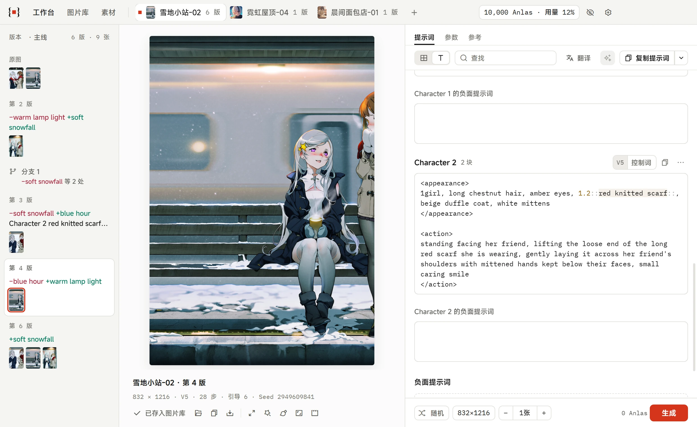
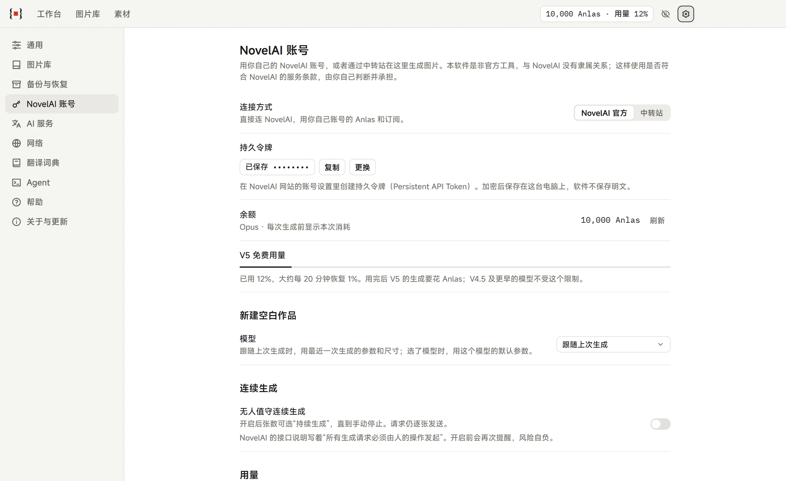
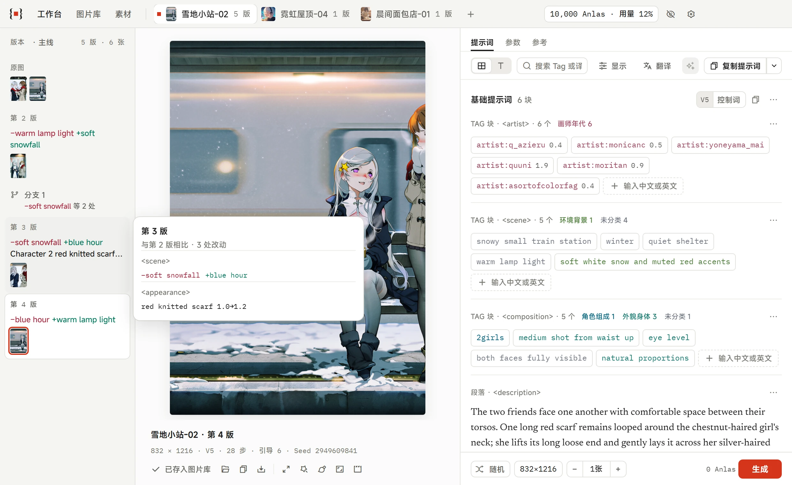
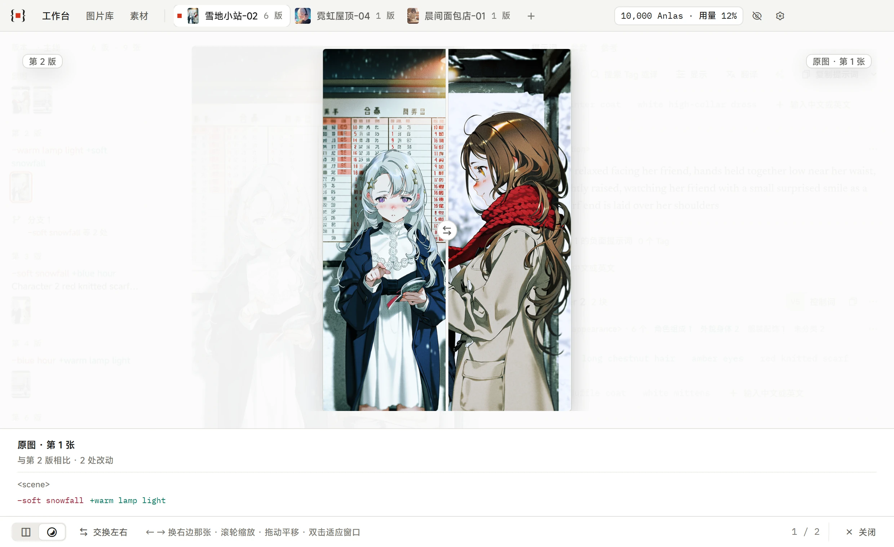
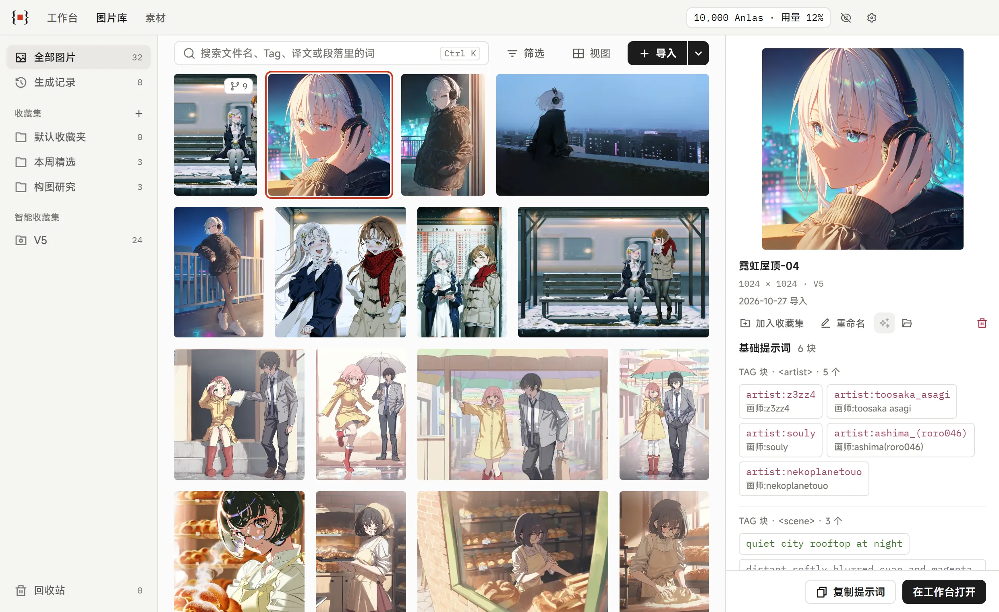
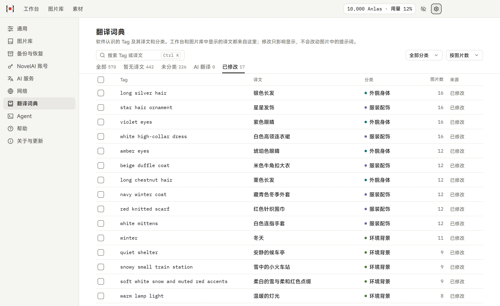
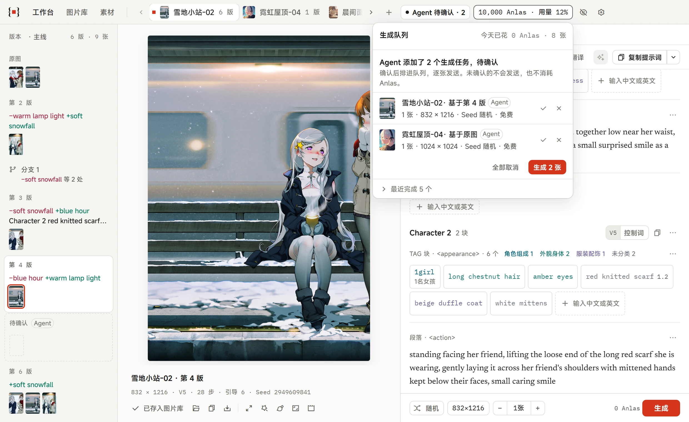

# 使用指南

NovelAI Prompt Studio 每个功能怎么用、在哪。软件里"设置 → 帮助"有同样的功能一览，可以搜索，点一下就跳过去。

[← 回到 README](../README.md)

- [打开图片](#打开图片)
- [工作台：把提示词看清楚](#工作台把提示词看清楚)
- [生成](#生成)
- [版本和分支](#版本和分支)
- [修图](#修图)
- [图片库](#图片库)
- [素材](#素材)
- [内置 AI](#内置-ai)
- [翻译词典](#翻译词典)
- [Agent 与命令行](#agent-与命令行)
- [数据与隐私](#数据与隐私)
- [支持范围](#支持范围)
- [快捷键](#快捷键)
- [常见问题](#常见问题)

## 打开图片

从文件、拖放或剪贴板打开图片，每张一个标签页。识别 NovelAI V4、V4.5 与 V5 写在图里的提示词、角色、负面提示词、参数和 Vibe。

点标签栏最右边的"+"新建空白作品（右键还是打开图片）。它的参数和尺寸沿用上次生成的设置，也可以在"设置 → NovelAI 账号"里固定一个模型；提示词是空的，写好就能生成。

每个标签页都有独立的草稿。标签页的顺序、当前看的图片和没改完的内容在重启后都会恢复，原图不会被覆盖或改写。

## 工作台：把提示词看清楚

### 提示词按"块"组织

NovelAI V5 的提示词常常是 Tag 和成段的自然语言混在一起。工作台把它们分开：一串 Tag 是一个 Tag 块，一段话是一个段落，各用各的方式显示和编辑。分块只影响显示，复制出去的文字和原来一个字符都不差。分得不对时，可以手动把一块转成另一种，软件会记住。

基础提示词、每个角色、负面提示词各是一节，可以单独复制。角色可以添加、改名、删除，每个角色有自己的负面提示词。块可以拖动或用 `Alt + ↑ ↓` 换位置。

### 文本方式：像 NovelAI 网页一样直接改



不习惯按块、按 Tag 改的，可以切到文本方式，直接改整段文字。写法和 NovelAI 网页一样：逗号分开，`1.2::rain::` 是权重，`{ }` `[ ]` 加强减弱。

- 输入时有补全，中文也能找到英文 Tag；指针停在一个 Tag 上可以看译文。
- 括号没配对、`::` 不成对时，那一处画上波浪线，下面写明是第几行出的问题。像 `0.8::artist:a,0.8::artist:b::` 这样前一块没写结束的 `::`，V5 和 V4.5 读法不一样，会提示并可以一键补上。
- 按每个字实际的权重铺底色：加强、减弱和负数各一种颜色，越强颜色越深。
- `Ctrl + E` 在按块和按文本之间切换，软件记住你选的方式。切回按块时重新分块，译文和分类都保留。

### 段落：对着中文改英文

点开一个段落，上面是英文、下面是中文，两边都能改。配置了 AI 服务后，可以"翻译成中文"，或者"根据中文改写英文"，权重、括号和 Panel 标签原样保留。发给 NovelAI 的始终是上面那一栏英文。

### Tag：输入时有提示

在一个 Tag 块里直接输入，下面会列出候选，输入中文也能找到对应的英文 Tag。候选来自内置的五万多条词典和你自己的翻译词典，不联网。用逗号或换行可以一次加多个。

点一个 Tag 可以改它的文字、译文、分类和权重；拖动可以换位置，可以跨块、跨角色。按住 Ctrl / Cmd 或 Shift 点选，或者从空白处拖出一个框，可以成批复制、移动、翻译或删除。

Tag 的英文按分类着色；每一块的标题右边列出这块里有哪些分类，指针停在一个分类上，同类的 Tag 会突出出来。

### V5 控制词

复杂度（`low` / `medium` / `high` / `ultra complexity`）、透明背景、年代感、视觉小说素材这些 V5 认得的特殊 Tag，工作台会认出来：左边标一小段"V5"，译文位置写中文名。提示词每一节的标题上有一个按钮，打开后按组点选添加；复杂度、年代感只能选一档，点另一档直接替换。同一节写了两档、当前模型不是 V5、或者写法和官方不一样时，会给出提醒。它们仍是普通的 Tag，原样发给 NovelAI。

### 只复制这一次真正需要的内容

"复制提示词"复制的是你现在看到的：筛选了就复制筛选出来的，选了几个就复制选中的。旁边的菜单里还有复制全部提示词、复制负面提示词、只复制基础提示词、带上 NovelAI 自动添加的内容。

译文不会混进复制的内容。只选了负面就复制负面；正面和负面都选了时只复制正面的，并告诉你没有包含几个负面 Tag，免得把负面粘进正面。

### 把 NovelAI 自动添加的内容和自己写的分开

对于可以确认的 NovelAI V4.5 / V5 质量 Tag 和负面预设，工作台会把它们收成一行说明。普通复制不带它们；需要完整复现时，可以选择带上。和官方模板不完全一致的内容，软件不会擅自当成自动添加的内容处理。

### 内置词典优先，AI 是可选的补全

软件内置由 [DanbooruSearchOnline（DSO）](https://github.com/SuzumiyaAkizuki/DanbooruSearchOnline) 固定版本转换而来的 52,475 条中文 Tag 译文，并用它的 93 个 Danbooru Tag Group 给常见的外貌、服装、动作、环境、构图和风格 Tag 分类。点"翻译"时，先用你自己改过的结果，再查内置词典和本地规则；内置词典里没有的 Tag 会到 Danbooru 查它属于哪一类（比如是不是画师）；最后还没有译文、而你又配置了 AI 服务的，才交给 AI 补全。

内置词典命中的翻译与分类不需要 AI，也不需要联网。所有结果都记在本机的翻译词典里，可以随时修改，你改过的始终优先。内置数据的版本、生成方式和原始许可证见[第三方数据说明](../third_party/DanbooruSearchOnline/README.md)。

## 生成

### 用你自己的 NovelAI 账号



在"设置 → NovelAI 账号"里填入持久令牌（在 NovelAI 网站的账号设置里创建）。令牌加密保存在本机，保存后旁边有"复制"，换电脑时不用再去网站取。配置好以后，标题栏一直显示 Anlas 余额和 V5 免费用量；同一页的"用量"按天、周、月统计花了多少 Anlas、生成了多少张，单独写出 Agent 用了多少。

不填也能用软件的其他功能，只是没有生成和版本栏。

也可以通过**中转站**生成：在同一页把"连接方式"换成"中转站"，填中转站给的地址和 Key，点"测试连接"会列出它能用哪些模型。中转站按它自己的价格计费，软件里不显示 Anlas，每日上限改按张数算；它编不了新的 Vibe 参考，也不支持导演工具。中转站是第三方服务，能看到你的提示词和生成的图，是否符合 NovelAI 的服务条款由你自己判断。

需要代理时，在"设置 → 网络"里选跟随系统、直连，或这台电脑上的 HTTP / SOCKS5 代理；生成、AI 服务、翻译和检查更新都按这里联网。

### 从一张图出发

生成以当前这一版的参数为起点，只改你改动的部分：提示词、角色、负面提示词、Seed、张数和尺寸（竖图、横图、方图，或者自定义），以及"参数"和"参考"页签里的设置。界面上改不了的参数原样带上。

- **参数**：提示词栏顶部的"参数"页签里可以换模型（V5、V4.5、V4 的 Full 和 Curated），调整 Effort、步数、引导强度、Rescale、采样器、噪声计划、质量 Tag、负面预设和角色位置。改过的那一行标出"已修改"，一键恢复成这一版的值。
- **参考**（V4.5）：增删、调整 Vibe（参考强度、信息提取）和精确参考（角色、风格、保真度）。Vibe 第一次编码要花 2 Anlas，编码后存进 Vibe 库，以后同一个模型再用不收费。两种参考不能同时用。
- **底图（图生图）**："参考"页签最上面放一张底图，按它出图，可以调强度和噪声；可以用当前这张、从文件选，或者在图片库里右键一张图"在工作台用作底图"。V5 和 V4.5 都能用。

### 生成前就知道要花多少

"生成"左边一直显示这次要花多少：免费时是 0 Anlas 和当前的 V5 用量，收费时是要花的 Anlas 和当前余额。不在免费范围时，会说明原因（尺寸、步数、Vibe 的个数和编码、精确参考）；尺寸或步数超了的，可以一键改回免费的范围。花钱只提醒，余额不够时才不能生成。

### 队列：一张接一张

全软件同一时间只有一个生成请求，一张发完再发下一张。生成中改了提示词再点"加入队列"，就是新的一份。标题栏的生成状态点开是队列：拖动排顺序、改张数、暂缓、跳过、移除（能撤销）；失败的一项停在原位写原因，后面的照常继续。重启软件后没跑完的留着，队列是暂停的，点"继续"才接着生成。

无人值守的连续生成（"持续生成，直到停止"）默认关闭，要在"设置 → NovelAI 账号"里手动打开，打开前会引用 NovelAI 条款的原文提醒一次。

### 随机池和随机块

"素材"里的随机池一行放一条画师串、动作或背景，每条可以调抽中的概率。提示词的块之间点"随机块"选一个池子、抽几个、能不能重复，还可以让抽到的每个 Tag 各自随机一个权重。每张图生成前各抽一次，生成 20 张就是 20 种组合，都算同一版。悬停缩略图能看到这张抽到了什么，满意的右键"用这张抽到的内容"固定进草稿。文本方式里写成 `__画师池__`、`__画师池*2__`。

### 关掉窗口也能接着跑

Windows 上关闭主窗口时会问一次：最小化到托盘，还是退出。缩到托盘后，生成和 Agent 接入在后台继续，点托盘图标就回来；右键托盘图标能看到生成进度，也可以从这里退出。之后可以在"设置 → 通用"里改。

## 版本和分支



- 一个**作品**是一张原图，加上从它改出来的各个版本，每一版下面是它生成的若干张图。作品存在图片库里，标签页只是打开它的窗口：关掉标签页不丢东西，从图片库打开作品里的任何一张图，都会回到这个作品、停在那一版。
- 从磁盘或剪贴板打开的图，第一次生成前会自动存进图片库（原文件不动）。
- 提示词和参数都没改（只换了 Seed、张数）就生成，图加进当前这一版；改了再生成，出新的一版。
- 回到旧版本接着改，自动分出新分支。从原图一路下来的叫"主线"，之后按先后叫"分支 1""分支 2"……可以改名。
- 版本栏只显示你正在走的这条线，别的分支在分叉处收成一行。每一版写着相对上一版改了什么，停一下就弹出完整对比。
- 右键一版可以"删除这一版"（后面还有版本时是"删除这一版和之后的 N 版"）或"只删除这一版"（后面的版本接到它的上一版下面），右键分支可以"删除分支"。图片移入回收站，通知里可以撤销。
- 一版就是它的那几张图：把一版的图都移进回收站，这一版就跟着移走；从回收站恢复，这一版也跟着回来。
- 改得够多、已经是另一幅作品了，就从一张图"作为新作品打开"，另起一个标签页，新旧两边可以互相跳。
- 一张图可以同时在几个作品里，图片库里只存一份。

### 挑图

一版里图多的时候，版本栏右键"挑图…"（一次生成 10 张以上，完成的通知里也有）：铺成网格，空格保留、X 不要，标完自动跳到下一张，Ctrl / Shift 可以多选一起标，Enter 看大图。挑完一键把不要的移入回收站，能撤销；挑到一半退出，标记还在。

### 两张图对比



版本栏里右键一张缩略图"和当前这张对比"，或者按住 Ctrl（macOS 是 Command）点两张：并排看或者叠在一起拖分界线看，下面写着两版提示词和参数的差异。修图后也可以"和修之前对比"。

## 修图

工作台图片下面一排操作，结果都是新的一版，版本栏里标着做了什么。每样都先写好送去的尺寸和价格。

- **放大**：宽高各放大 2 倍、画面不变，按原图大小花 1–4 Anlas。
- **增强**：用这张图那一版的提示词重新细化一遍，可以选幅度和放大档位（V5 有 Max）。
- **局部重绘**：在图上涂要重画的地方，软件自动框出一块不超过免费尺寸的范围，多带一些周围的内容；也可以先用"框"拖出范围再涂。只重画涂过的地方，画完自动贴回原来的位置。重绘时右边的提示词栏照常能改，可以临时加 `close-up`、`hand` 这类 Tag；版本栏写出这次重绘用了什么提示词，"再来一次"用同样的框和涂抹再画一次。
- **扩图**：拖四条边往外拉大画布，或者点 16:9、1:1 这些比例两边均匀扩，新区域由 AI 画出来，接缝自然。可以一次画完，也可以按边分块。提示词写新区域里要有什么，照搬原图的提示词容易再画一个主体。
- **导演工具**：去背景、线稿、草图、上色、换表情、去杂物。上色可以写想要的颜色，换表情有 24 种，两样都能调强度。去背景一次得到三张：抠图、补全被挡住的部分、两者混合。约 100 万像素时一般 20 Anlas，有 Opus 免费；去背景和去杂物 65 Anlas。中转站不支持。

## 图片库



- 导入 `PNG`、`JPG`、`JPEG`、`WEBP` 或 NovelAI 导出的 `ZIP`，支持多选、拖放和剪贴板。内容相同的图片会自动跳过。
- **导入整个文件夹**：每个装着图片的文件夹建一个收藏集，用文件夹的名字，已有同名收藏集的并进去，以后往文件夹里加了图，再导入一次就补齐。导入前先看一遍：文件夹树、每个几张、会建哪些收藏集、要占多少空间。
- 图片按原来的比例等高排列。选中一张，右边直接显示它的提示词，可以当场复制，也可以送到工作台里接着改。
- **分组**：默认按作品，一个作品的原图和它生成的图是一组；也可以按提示词（完全相同、基础相同、相似）分组，或者不分组。
- 按文件名、Tag、译文或段落里的词搜索，并结合包含 / 排除 Tag、模型、Vibe、NSFW 与导入时间筛选。导入时间用日期范围选。
- 用收藏集手动整理；或者把当前的筛选存成**智能收藏集**，图片实时跟着变。
- 侧栏的**生成记录**列出软件生成的全部图片，最新的在前，每张写着是第几版、是不是 Agent 生成的。
- 可以给一张或一批图片起名，成批起名会按顺序编号；起过名的作品里生成的图显示成"作品名 · 第 2 版"。图片文件本身不改名。
- **透明图**：V5 生成的透明背景图下面垫着棋盘格；复制图片时放进剪贴板的是原文件，Windows 上同时附一份带透明的位图。
- **导出分享**：多选几张后点"导出…"，或者在一组、一个收藏集上右键"导出"，导出成 ZIP 或文件夹。导出的是原图，提示词和参数都在图里，对方拖进本软件就能看到。
- **图片模糊**："设置 → 通用"里可以只模糊 NSFW 的图（按提示词里的 Tag 判断，敏感词可以增删，判断错了右键改），或者所有图片都模糊。标题栏齿轮左边的眼睛按钮一键模糊全部。只影响显示，复制、导出、备份的都是原图。

删除只是把软件里的那一份移进回收站，可以撤销，也可以随时恢复。要删的图同时在别的作品里时，会先问是只从这个作品去掉，还是移入回收站。永久删除和清空回收站都要确认，还被别的作品用着的文件不会从磁盘删掉。"设置 → 图片库"可以打开"自动清理回收站"（默认关），超过 30 天的自动永久删除。

## 素材

用得多的一段 Tag 或一段描述，在块的菜单里"存为常用块"；调好的角色在角色的菜单里"存为角色"。以后在两块之间点"常用块"，或者点"添加角色"旁边的箭头，就能插进当前的提示词，插进去的是一份副本。

导航里的"素材"页按常用块、角色、Vibe、随机池分开列出，可以搜索、展开看完整内容和用过它的图片、编辑、另存为新的、重命名，删除后可以撤销。

## 内置 AI

在"设置 → AI 服务"里选一种：

- **ChatGPT 账号**：点"登录 ChatGPT"，在浏览器里授权，起名、翻译和整理提示词就算在你的 Plus 或 Pro 套餐里，不用另外配置 API Key；免费账号能登录，但用不了套餐额度。另有一个默认关闭的"用 Codex 的方式登录（非官方）"，打开后能看到剩余额度，打开前会说明它的风险。
- **API Key**：任何兼容 OpenAI 接口格式的服务，填地址、API Key 和模型。

AI 能做三件事：

- **整理提示词**：工作台点"整理"，AI 读一遍这张图的提示词，给出几处有理由的修改（重新分块、改判块的类型、修正明显的错误），你逐处接受或放弃。整理期间不能生成。
- **根据提示词起名**：图片库多选后点"起名"，结果先列出来，每一项都能改，确认后才写进图片库。
- **翻译**：补全内置词典里没有的 Tag，翻译和改写段落。

## 翻译词典



"设置 → 翻译词典"列出软件认识的所有 Tag 和它们的译文、分类。默认按"用在几张图里"排序，常用的在前面；上面的分页签直接分出暂无译文的、未分类的、AI 翻译的、你改过的。点译文就在格子里改，回车跳到下一行；选中一批可以统一设置分类，或者让 AI 重新翻译。

## Agent 与命令行



软件提供命令行工具 `nai-studio` 和一份配套的 Agent 技能。Claude Code、Codex 这类能运行命令的 Agent 用上它们，就能用和界面同一套能力。

- **安装**：在"设置 → Agent"里安装命令行工具，再把 Agent 技能放进你的 Agent 的技能目录（可以打开技能所在的文件夹，或者直接复制内容）。
- **只在这台电脑上**：`nai-studio` 连到正在运行的软件上执行命令，不直接读写数据库，也不开网络端口。软件没开时会先把它打开。输出一律是 JSON。
- **能做什么**：读提示词和参数、工作台、图片库和翻译词典；新建空白作品；改工作台的草稿（块、Tag、权重、段落、角色、尺寸、参数和参考）；用随机池；删除分支（只进回收站）；导入图片、存入图片库、起名、整理收藏集、修改翻译词典；排队生成，发起放大、增强、扩图、局部重绘和导演工具；读队列和用量。
- **不能做什么**：永久删除、清空回收站、改设置、读取或复制任何密钥、确认或放弃待确认的生成、暂停或排队列顺序。这些限制写在软件的命令层里，不靠界面拦。
- **改了看得见、撤得回**：Agent 改了当前标签页，提示词原地更新，通知"Agent 修改了提示词"，带"撤销"。你正在输入的那一块不会被冲掉。

Agent 花钱的操作默认等你确认：标题栏出现"Agent 待确认 · N"，点开能看到每一项对哪张图做什么、基于第几版、改了什么、几张、多少钱，局部重绘和扩图带一张预览小图。可以一个个确认、移除，或者全部取消。确认后照样一张接一张地发，Agent 的生成另起一版，不换你正在看的图。"直接生成"（不用确认）要在"设置 → Agent"里手动打开；每日花费上限打开后，到了就暂停 Agent 的生成。

```sh
nai-studio app.status
nai-studio workbench.list
nai-studio library.search --json '{"query":"rain","limit":20}'
```

`nai-studio help` 列出当前版本支持的全部命令；用法和边界见 [Agent 技能](../agent/SKILL.md)。

## 数据与隐私

图片、草稿、版本记录、翻译词典、图片库和设置都保存在这台电脑上。软件本身不需要注册账号；生成用的是你自己的 NovelAI 账号。图片只在修图、图生图和编码 Vibe 时发送用到的那一张，其他时候不会离开这台电脑。

| 操作 | 对原图的影响 | 会不会联网 |
| --- | --- | --- |
| 打开到工作台 | 只读，不复制、不改写 | 不会 |
| 存入或导入图片库 | 另存一份由软件管理的副本 | 不会 |
| 编辑、筛选或复制提示词 | 只改本机的草稿 | 不会 |
| 生成和修图 | 不改原图；第一次生成前原图另存一份进图片库，结果也存进图片库 | 用你的持久令牌把提示词和参数发给 NovelAI；带 Vibe 的图带上 Vibe 编码；修图和图生图会把要处理的那张图发过去，编码新的 Vibe 会发参考图 |
| 查询余额 | — | 打开软件、每次生成结束和点"刷新"时，向 NovelAI 查询 Anlas 余额和用量 |
| 用中转站时 | — | 生成请求改发到你填的中转站地址，用中转站的 Key；不查 Anlas，改成读取它有哪些模型 |
| 导出分享、导出备份 | 不改原图 | 不会：写到你选的位置 |
| Agent 通过命令行操作 | 和你在界面里操作一样 | 不会：命令行工具只在这台电脑上和软件通信，不开网络端口 |
| 翻译与分类：内置词典里有的 Tag | 不改原图 | 不会 |
| 翻译与分类：内置词典里没有的 Tag | 不改原图 | 把 Tag 的名字发给 Danbooru 查类别；配置了 AI 服务时，还没有译文的再发给你配置的服务 |
| 段落翻译、改写，整理，起名 | 不改原图 | 把相关的提示词文字发给你配置的 AI 服务 |
| 用 ChatGPT 账号时 | — | 上面发给 AI 服务的内容发给 OpenAI（api.openai.com）；打开"用 Codex 的方式登录"后改发到 chatgpt.com，并向它查询剩余额度 |
| 检查和下载更新 | — | 访问 GitHub，自动检查可以关掉 |
| 报告问题、提出建议 | — | 在浏览器里打开 GitHub，不自动附带任何数据 |

- 除了修图、图生图和编码 Vibe 用到的那一张，任何情况下都不会发送你的图片。
- NovelAI 的持久令牌、中转站的 Key、AI 服务的 API Key 和 ChatGPT 的登录信息都用系统自带的加密能力保存在本机，软件不保存明文；诊断信息、报告问题和备份都不会带上它们。设置里的"复制"由软件直接写进剪贴板，Agent 和命令行不能复制。
- 从图片库里删除不会动你最初导入的那个文件。另存图片时保留原来的格式和里面的生成信息。
- 图片库的存放位置可以更改；新位置的文件复制完成并确认无误之前，原来的文件不会被删除。

### 备份与恢复

"设置 → 备份与恢复"把提示词、版本、收藏集、词典、素材记录和设置导出成一个 `.npsbackup` 文件；换电脑请勾"包含图库"，连图片文件一起打包。恢复是替换现在的数据，不合并；恢复前自动留一份，下一次恢复之前都可以撤回。令牌、Key 和登录不在备份里，恢复后重新填。

## 支持范围

| 类别 | 当前支持 |
| --- | --- |
| 操作系统 | Windows x64、macOS Apple 芯片、macOS Intel |
| NovelAI 提示词 | Diffusion V4、V4.5、V5 |
| 在软件里生成 | V5 Full / Curated、V4.5 Full / Curated、V4 Full / Curated Preview；图生图（V5、V4.5）；放大、增强、局部重绘、扩图、导演工具 |
| 工作台图片 | PNG、JPG / JPEG、WEBP |
| 图片库导入 | PNG、JPG / JPEG、WEBP、NovelAI ZIP、整个文件夹 |
| 图片里的生成信息 | NovelAI 写在 PNG 里的文本信息，以及可以识别的 Stealth PNG 信息 |
| Vibe | 识别图里的 Vibe，可以导出能恢复的 `.naiv4vibe`；V4.5 可以在"参考"里增删、调整 |

JPG、WEBP、截图以及被社交平台压缩过的图片仍然可以打开和收藏，但如果里面的生成信息已经丢了，就恢复不出完整的提示词。

## 快捷键

macOS 上 `Ctrl` 对应 `Command`，`Alt` 对应 `Option`。在输入框里，`Ctrl + V` 仍然是普通的粘贴。完整的列表在软件里的"设置 → 帮助 → 快捷键"。

| 快捷键 | 作用 |
| --- | --- |
| `Ctrl + I` | 打开图片；在图片库里是导入 |
| `Ctrl + V` | 从剪贴板打开或导入图片 |
| `Ctrl + K` | 聚焦搜索框 |
| `Ctrl + Tab` / `Ctrl + Shift + Tab` | 下一个 / 上一个标签页 |
| `Ctrl + W` | 关闭当前标签页 |
| `Ctrl + E` | 工作台：切换按块 / 按文本编辑 |
| `Alt + 方向键` | 工作台：移动当前 Tag 或块 |
| `←` / `→` | 工作台：在这一版的图之间切换 |
| 方向键、`Enter` / `Space` | 图片库：移动；在工作台打开 / 看大图 |
| `Ctrl + A` | 图片库：全选 |
| `Esc` | 取消选择；关闭大图 |

## 常见问题

<details>
<summary><strong>会修改我的原图吗？</strong></summary>

不会。工作台只读取原图，改动存在独立的草稿里；图片库保存的是软件自己管理的一份副本。从图片库里删除也不会动你最初导入的那个文件。
</details>

<details>
<summary><strong>生成要花钱吗？</strong></summary>

和在 NovelAI 网页上生成一样，按 NovelAI 的规则扣你账号里的 Anlas 或 V5 免费用量，软件本身不收费。在免费范围内（例如 Opus 套餐下不超过 1024×1024、不超过 28 步）不花 Anlas；超出时，生成前会说明原因和要花多少，并且可以一键改回免费的尺寸。
</details>

<details>
<summary><strong>用的是谁的账号？</strong></summary>

你自己的。生成用的是你在"设置 → NovelAI 账号"里填的持久令牌，花的是你账号里的 Anlas 和用量。软件不提供账号，也不经过任何中间服务器（除非你自己选了中转站）。令牌加密保存在本机，Agent 读不到它。
</details>

<details>
<summary><strong>这样用符合 NovelAI 的条款吗？</strong></summary>

NovelAI 的公开接口文档写明了第三方工具可以向用户索取持久令牌，所以用自己的令牌接第三方客户端是官方描述过的用法。但它的生成接口说明里写着"所有生成请求必须由人的操作发起"，服务条款里也有针对自动化系统的限制；风险主要在无人值守的连续生成和 Agent 自行发起的生成。

所以软件默认：请求一个接一个地发；无人值守的连续生成默认关闭，打开前引用条款原文提醒；Agent 的生成默认要你确认。这是非官方工具，**是否符合 NovelAI 的服务条款，由你自己判断并承担**。
</details>

<details>
<summary><strong>必须配置 AI 服务才能用吗？</strong></summary>

不需要。内置词典可以离线翻译和分类它收录的 Tag；AI 只用来补全词典里没有的、翻译成段的文字、整理和起名。查看、编辑、复制提示词、生成和图片库都不依赖 AI 服务。
</details>

<details>
<summary><strong>为什么从剪贴板打开后没有提示词？</strong></summary>

软件会优先读取剪贴板里的原始图片数据。但网页上的"复制图片"、截图工具和一部分软件只提供重新编码后的画面，这时图片里的生成信息已经没有了。
</details>

<details>
<summary><strong>数据保存在哪里？</strong></summary>

在系统给每个软件分配的数据目录里：数据库是 `data/studio.sqlite`，图片库的副本和缩略图在 `assets/`。具体位置可以在"设置 → 图片库"里看到，图片的存放位置也可以在那里更改。
</details>

<details>
<summary><strong>这是 NovelAI 官方的软件吗？</strong></summary>

不是。这是面向 NovelAI 工作流的第三方工具，与 NovelAI 或 Anlatan 没有隶属或背书关系。
</details>
